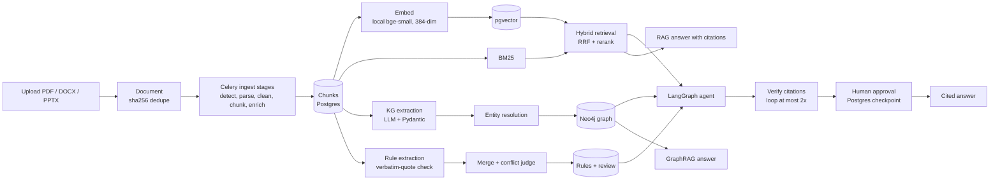

# Architecture

DocIntel Lab is one Django project with one app per module. It runs as five Docker Compose services.

## Components

| Component | Role |
|---|---|
| `web` (Django 5, port 8010) | Pages, HTMX polling, admin, management commands |
| `worker` (Celery, prefork) | Ingest stages, knowledge-graph builds, rule extraction, agent runs |
| `postgres` (pgvector, pg16) | All relational data, 384-dim chunk vectors, LangGraph checkpoints |
| `redis` | Celery broker and the cross-process LLM concurrency limit |
| `neo4j` | Knowledge-graph store (a NetworkX JSON file is the alternative) |

Shared code lives in `core/`:

- `llm.py`: `structured_call` sends a prompt to the configured provider (Google, Anthropic, OpenAI, or the mock for tests). It validates the reply against a Pydantic schema, sends validation errors back for a retry, backs off on 429s, and logs every call as an `LLMCall` row.
- `embeddings.py`: local sentence-transformers, OpenAI, or a deterministic mock. All produce 384 dimensions.
- `prompts.py`: renders versioned Jinja2 templates from `prompts/<task>/<version>.md` with few-shot examples and the JSON schema.
- `graph_store.py`: one interface over Neo4j and NetworkX.
- `models.py`: `EvalRun` and `LLMCall`. Every eval stores its provider, model, metrics and markdown report.

| App | Module | Main services |
|---|---|---|
| `apps/ingest` | 1 | `services/stages.py`, with a parser per format (`parse_pdf.py`, `parse_docx.py`, `parse_pptx.py`, `parse_text.py`), `chunk.py` and `tasks.py` |
| `apps/prompts` | 2 | v1 vs v2 eval over `prompts/answer_with_citations` and `prompts/extract_single_rule` |
| `apps/rag` | 3 | `bm25.py`, `retrieve.py`, `fusion.py` (reciprocal rank fusion), `rerank.py`, `answer.py` |
| `apps/kg` | 4 | `extract.py`, `normalize.py` and `resolve.py` (entity resolution), `build.py`, `graphrag.py` |
| `apps/rules` | 5 | `extract.py` (quote check), `merge.py`, `conflicts.py` (LLM judge), `present.py`, `export.py` |
| `apps/qa_gen` | 6 | `services/generate.py` (per chunk and per graph-linked pair), `verify.py` (quote check, threshold), `pairs.py`, `evaluate.py` (Search accuracy per type and mode) |
| `apps/codegen` | 7 | `graph.py` (LangGraph loop), `sandbox.py` (static check + pytest subprocess), `render.py` (test rendering, mutation), `contract.py` (fixed `Decision` type), `evaluate.py` |
| `apps/agents` | 8 | `graph.py` (LangGraph `StateGraph`), `nodes.py`, `tools.py`, `trace.py` |

## Data flow

1. **Upload.** A file is stored under `MEDIA_ROOT`, and a `Document` row is created. A file whose sha256 is already stored is not ingested again.
2. **Ingest.** The worker runs detect, parse, clean, chunk, enrich, embed and index as separate Celery stages. Each stage records its attempts and duration. Chunks are split on headings and keep their page, section path and identifiers (part numbers, directive numbers). Vectors go to pgvector. See [docs/pipeline.md](docs/pipeline.md).
3. **Retrieval.** Chunks are searched by BM25 over their text and by cosine similarity in pgvector. The two lists are fused with reciprocal rank fusion and optionally reranked. Answers cite the document, page and section.
4. **Knowledge graph.** When an ingest run finishes, each new chunk is sent to the extraction prompt. Entities and relations are validated, and a relation is dropped when its evidence quote is not in the chunk. Entities are resolved by normalized identifiers and written to Neo4j, with the source chunk on every node and edge. GraphRAG links question entities, walks one or two hops, and adds the linked chunks to the hybrid results.
5. **Rules.** Each chunk is sent to `extract_rules`. A rule is kept only when its source quote appears verbatim in the chunk. Near-duplicates are merged, and candidate pairs go to an LLM judge for conflicts. People review the rules on `/rules/` (approve, edit, reject) and export them as JSON or CSV.
6. **Agent.** A question goes through classify, plan, hybrid search, graph lookup, rule check, draft and citation verification. A failed verification loops back to retrieval at most twice. The run then pauses for human approval, with its state checkpointed in Postgres, and resumes on the worker.
7. **Evals.** Each module has a management command that writes an `EvalRun` and a markdown report under `evals/results/`. The curated summary is [evals/REPORT.md](evals/REPORT.md).

## Design choices

- **Every LLM output is a Pydantic object.** No free-text parsing. A validation failure is retried with the error message.
- **Provenance everywhere.** Chunks, graph edges, rules and agent claims carry a document, page and verbatim quote. The quote is checked against the source text in code, not by the model.
- **Explicit providers.** A real provider with a missing key fails at startup. The mock provider exists only for the offline tests (`conftest.py` forces it).
- **Cached extractions.** KG extractions are cached per chunk and prompt version. Rule extractions are cached per chunk, prompt version, model and chunk text hash. Reruns do not resend unchanged chunks unless forced.
